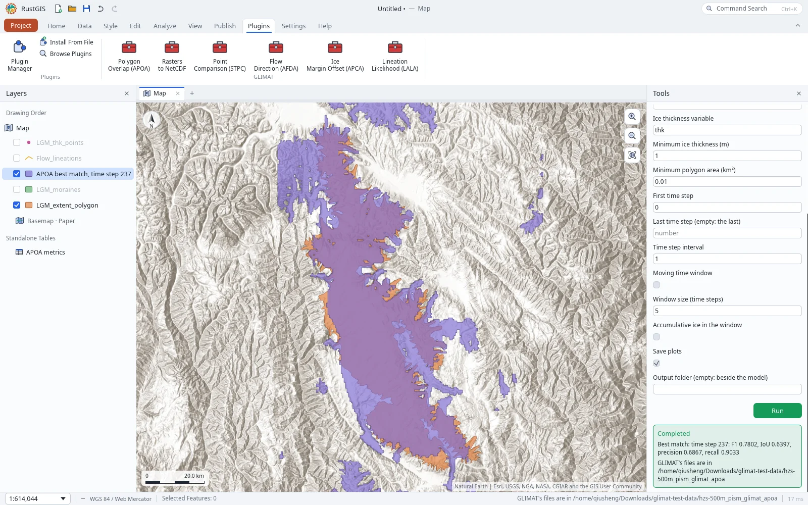
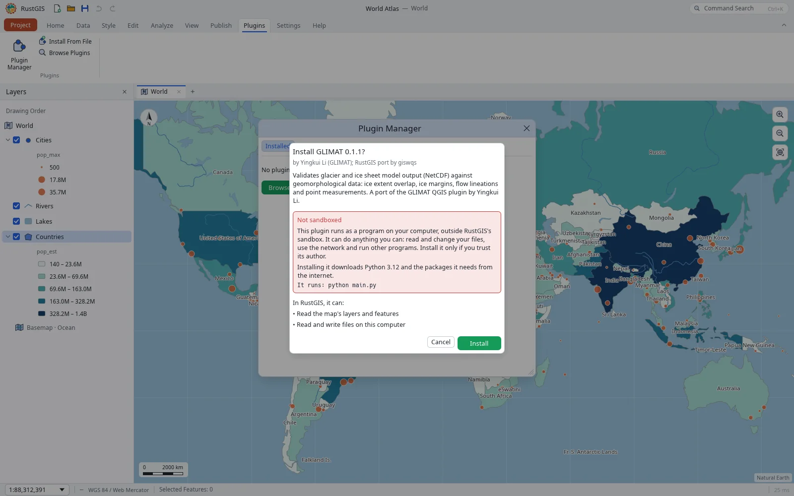
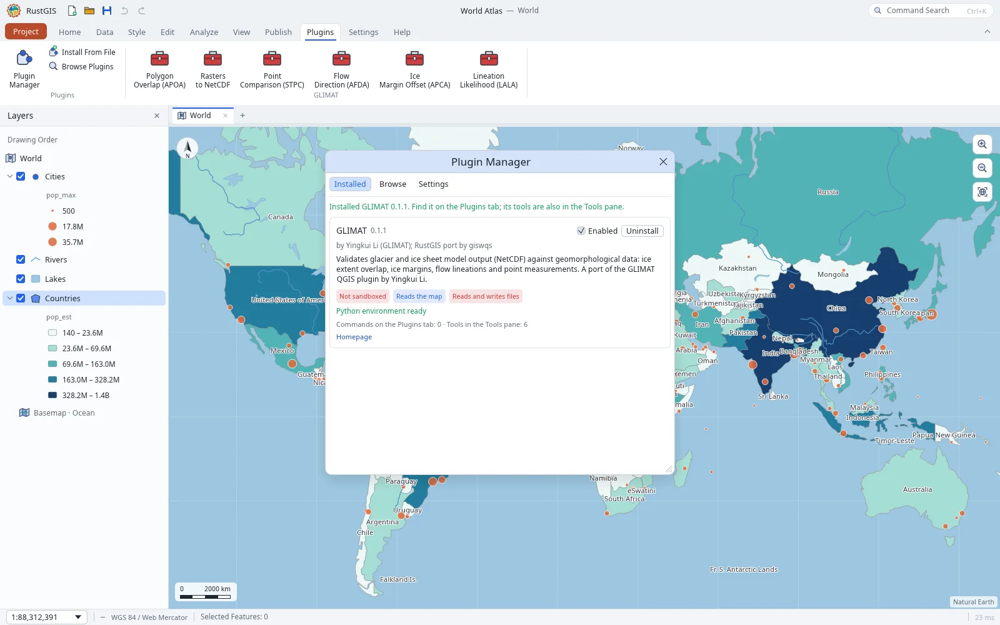
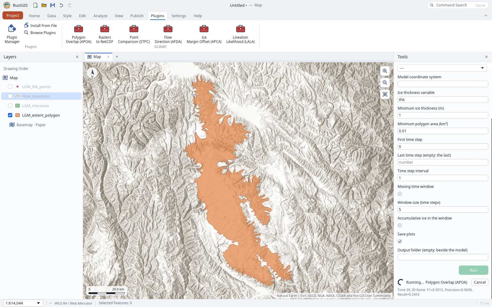
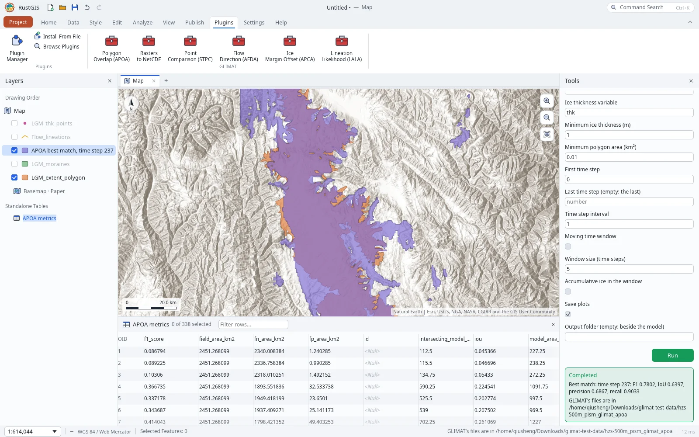
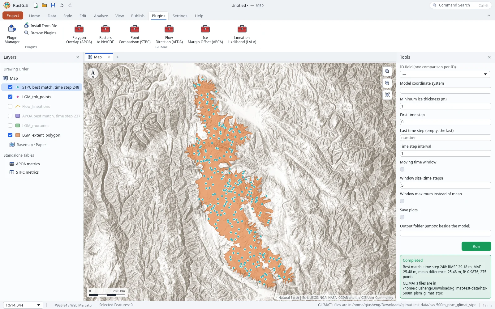

# GLIMAT for RustGIS

A port of [GLIMAT](https://github.com/yingkui2003/glimat) (Glacier Lineation and Ice Margin Analysis Toolkit), the QGIS plugin by Yingkui Li, to a [RustGIS](https://github.com/opengeos/RustGIS) plugin.

GLIMAT validates glacier and ice sheet model output (NetCDF) against geomorphological data with five tools:

- **APCA**, Automated Proximity and Conformity Analysis: modelled vs mapped ice margins.
- **AFDA**, Automated Flow Direction Analysis: modelled flow directions vs mapped lineations.
- **LALA**, Likelihood of Accordant Lineations Analysis.
- **APOA**, Automated Polygon Overlap Analysis: F1, IoU, precision and recall of ice extent.
- **STPC**, Surface/Thickness Point Comparison: RMSE, MAE and R² at measured points.



## Status

All of GLIMAT's tools are ported: APOA, STPC, APCA, AFDA and LALA, and the raster to NetCDF converter. On the [GLIMAT test dataset](https://zenodo.org/records/22836601) (a 1.87 GB model with 338 time steps), each tool's results match those of GLIMAT's own code run as its QGIS dialog runs it, to floating-point precision.

The plugin is a RustGIS **process plugin**: RustGIS runs `main.py` with Python, which runs GLIMAT's own code in `glimat/` (unchanged from GLIMAT v1.0.0) and hands the results back as layers and tables. That lets it read model output of any size in place, as the QGIS plugin does. It needs a RustGIS with [process plugins](https://github.com/opengeos/RustGIS/issues/241), on the desktop or the command line.

## Install

Download `glimat-<version>.rgplugin` from the [releases](https://github.com/giswqs/glimat-rustgis/releases) and drop it on the RustGIS window, or install it in **Plugins › Plugin Manager › Settings**, or run `rustgis-cli plugins install glimat-<version>.rgplugin`. RustGIS asks before installing it, since it runs as a program on your computer rather than in RustGIS's sandbox.



To run it from a clone instead, add the clone's folder as a plugin folder in **Plugin Manager › Settings**, or run `rustgis-cli plugins install /path/to/glimat-rustgis`.

RustGIS then makes GLIMAT a Python environment of its own, with Python 3.12 and the packages in `requirements.txt`. The desktop app does it in the background and shows the progress in the Plugin Manager; `rustgis-cli` does it before the install returns. You don't need Python installed. The first time downloads about 600 MB. This needs a RustGIS with [plugin Python environments](https://github.com/opengeos/RustGIS/pull/246).



For development, `GLIMAT_PYTHON` names another interpreter to run GLIMAT with, such as a conda environment's `python` that has the packages in `requirements.txt`.

## Tools

The tools are in the **Tools** pane under **Plugins › GLIMAT**. Each one reads the model output (NetCDF) in place by its path, and reprojects the mapped data, a RustGIS layer, to the model's coordinate system. That system is read from the NetCDF, or given as **Model coordinate system** (an EPSG code). The options match the QGIS plugin's. GLIMAT's own CSV files, summaries and plots go to an output folder, by default `<model>_glimat_<tool>` beside the model. While a tool runs, the Tools pane shows what GLIMAT is doing, such as the time step it is on (with a RustGIS that has [progress messages](https://github.com/opengeos/RustGIS/pull/279)); GLIMAT's full output is in RustGIS's log.

| Tool | Compares | Gives back in RustGIS |
|---|---|---|
| **Polygon Overlap (APOA)** | modelled ice extent with a mapped extent polygon: F1-score, IoU, precision, recall | a metrics table per time step, the best-matching modelled ice as a layer |
| **Point Comparison (STPC)** | modelled surface elevation or thickness with measured points: RMSE, MAE, mean difference, R² | a metrics table per time step, the points with modelled and measured values at the best time step |
| **Ice Margin Offset (APCA)** | the modelled ice margin with mapped margins (moraines): mean offset and its trend | an offsets table per time step, the best match's offsets per feature, the best-matching modelled outline as a layer |
| **Flow Direction (AFDA)** | modelled flow direction with mapped flow lineations: angular statistics | a statistics table per time step, with the best agreement in the messages |
| **Lineation Likelihood (LALA)** | how likely the simulation is, given the lineations' locations and directions | the lineations' midpoints with their scores as a layer, a summary table |
| **Rasters to NetCDF** | (converts) folders of GeoTIFF or ASCII grid rasters, one per time step, into one NetCDF | the NetCDF written, ready for the other tools |

A tool runs in the background, so the map stays usable. The Tools pane shows the line GLIMAT last printed, such as the time step it is on, and a **Cancel** button:



The results come back as layers and tables. APOA's metrics table has a row per time step:



STPC adds the measured points with the modelled values at the best time step:



The screenshots use the [GLIMAT test dataset](https://zenodo.org/records/22836601) on Esri's World Hillshade.

### Notes on GLIMAT's numbers

The port reproduces GLIMAT v1.0.0's results exactly, including these behaviours of GLIMAT's own code:

- **APOA and APCA** position the model grid by its outermost cell centres rather than its edges, so modelled polygons and outlines are offset by half a cell.
- **AFDA** counts frozen-bed and ice-free cells as 180° in its mean angular difference, so on most models the mean stays near 180° and the *normal alignment* share says more. GLIMAT names no best time step for AFDA; the port reports the one with the smallest mean angular difference.
- **LALA** finds each lineation's grid row in a flipped y axis but reads the unflipped data. It also subtracts the lineation's direction (degrees clockwise from north) from the flow direction (radians anticlockwise from east). Both affect its scores.
- **STPC** counts points with no ice (below the minimum thickness) or no data as a modelled value of 0.
- **APCA** accepts an ice threshold but doesn't use it, and groups its results by time step even with an ID field.

## Development

Install the [pre-commit](https://pre-commit.com) hooks once, and they check each commit:

```sh
pip install pre-commit
pre-commit install
pre-commit run --all-files   # check everything now
python -m pytest tests        # run the plugin as RustGIS does, on a synthetic model
```

GLIMAT's own modules in `glimat/` are left out of the hooks, so they stay identical to the upstream release.

## Releasing

`python scripts/package.py` builds `dist/glimat-<version>.rgplugin` and prints its SHA-256; the same files always give the same package, on any machine. To publish a release, set `version` in `plugin.json`, merge, and push the tag `v<version>`: CI runs the tests, builds the package and attaches it, with its SHA-256, to a GitHub release.

## Credits and licence

GLIMAT is by Yingkui Li (University of Tennessee). The analysis code in `glimat/` is his, from [yingkui2003/glimat](https://github.com/yingkui2003/glimat), licensed under the GNU General Public License v3.0. This port is licensed under the same terms; see [LICENSE](LICENSE).

`requirements-upstream.txt` lists the library versions GLIMAT was tested with.
